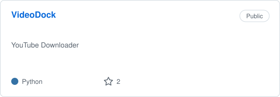
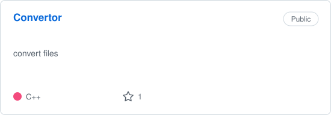
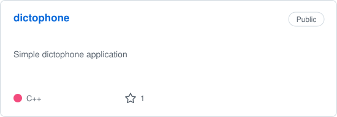
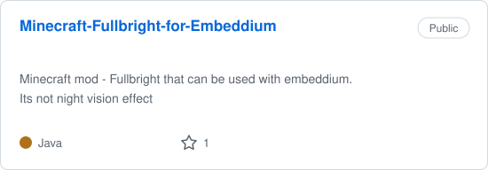
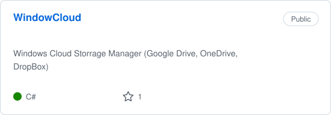

# Привет, я Frish07 👋

Создаю приложения, инструменты и моды. Здесь — мои проекты с открытым исходным кодом.

[Все репозитории →](https://github.com/Frish07?tab=repositories)

## Популярные репозитории

<!-- POPULAR-REPOS:START -->

  <a href="https://github.com/Frish07/VideoDock">
    <picture>
      <source media="(prefers-color-scheme: dark)" srcset="assets/repositories/1-dark-daad0e95d274.svg">
      
    </picture>
  </a>
  <a href="https://github.com/Frish07/Convertor">
    <picture>
      <source media="(prefers-color-scheme: dark)" srcset="assets/repositories/2-dark-40a2677f8c0c.svg">
      
    </picture>
  </a>
  <a href="https://github.com/Frish07/dictophone">
    <picture>
      <source media="(prefers-color-scheme: dark)" srcset="assets/repositories/3-dark-8b100229ff78.svg">
      
    </picture>
  </a>
  <a href="https://github.com/Frish07/Minecraft-Fullbright-for-Embeddium">
    <picture>
      <source media="(prefers-color-scheme: dark)" srcset="assets/repositories/4-dark-f480c276aede.svg">
      
    </picture>
  </a>
  <a href="https://github.com/Frish07/VideoEditor">
    <picture>
      <source media="(prefers-color-scheme: dark)" srcset="assets/repositories/5-dark-2a546ffaa54f.svg">
      
    </picture>
  </a>
  <a href="https://github.com/Frish07/WindowCloud">
    <picture>
      <source media="(prefers-color-scheme: dark)" srcset="assets/repositories/6-dark-40f76f12ab49.svg">
      
    </picture>
  </a>

<!-- POPULAR-REPOS:END -->

Топ по количеству ⭐ среди моих публичных репозиториев, без форков. Карточки автоматически обновляются каждые 30 минут; GitHub может задерживать запуск и кэшировать изображения.
